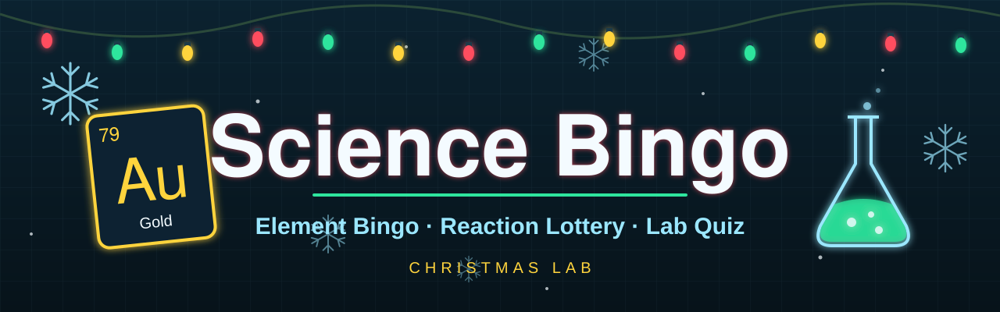
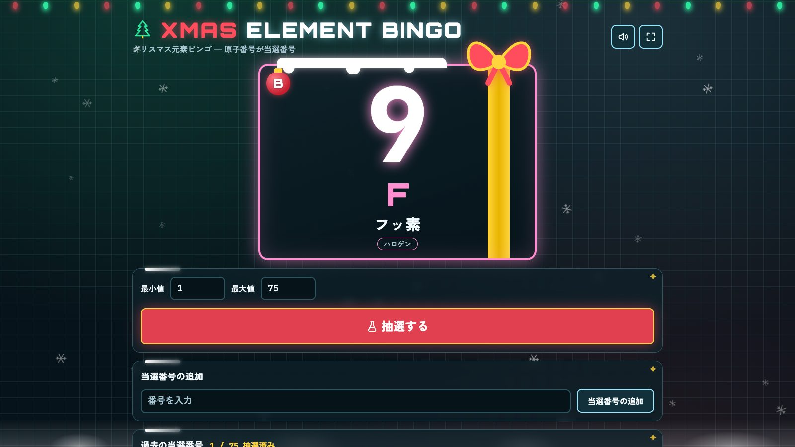
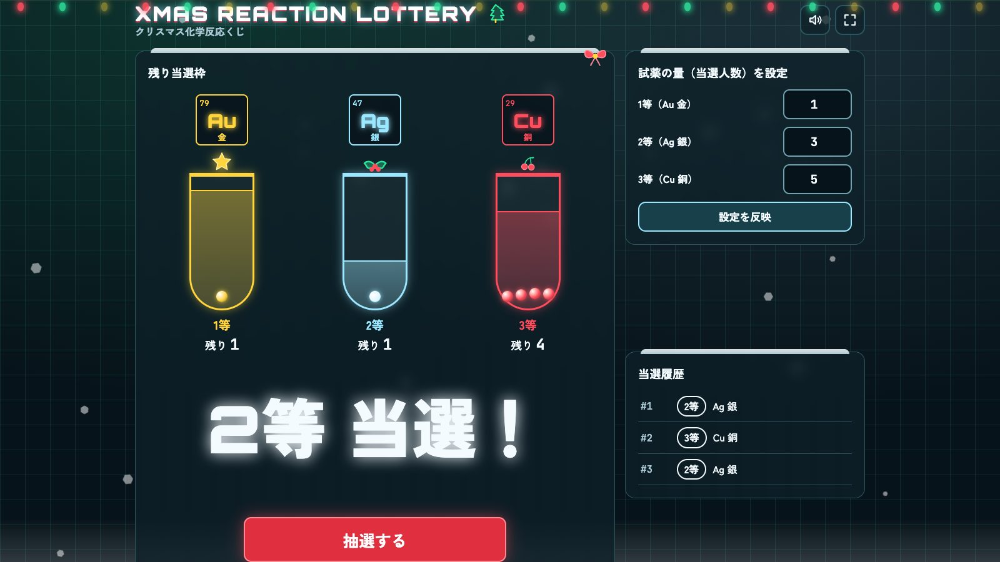
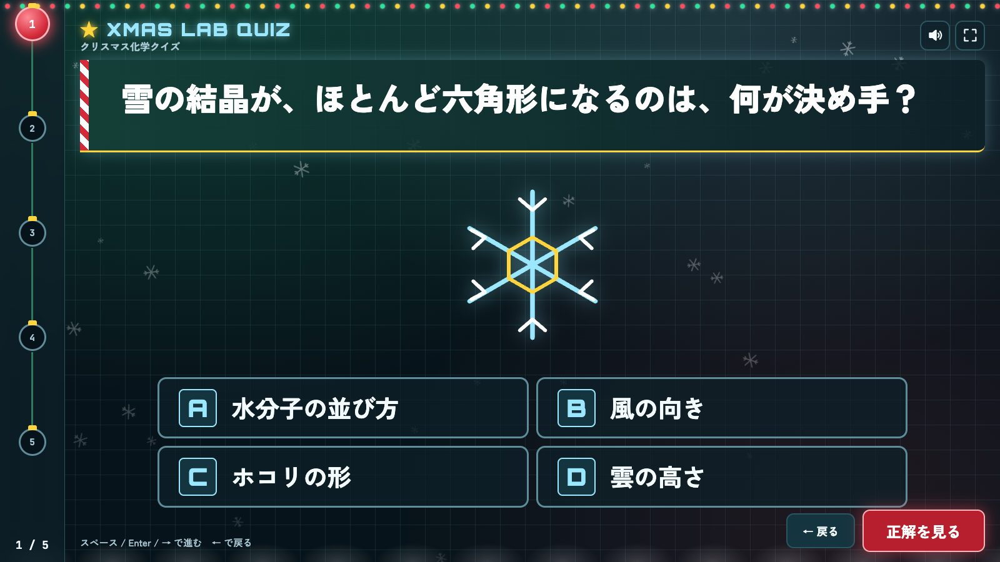
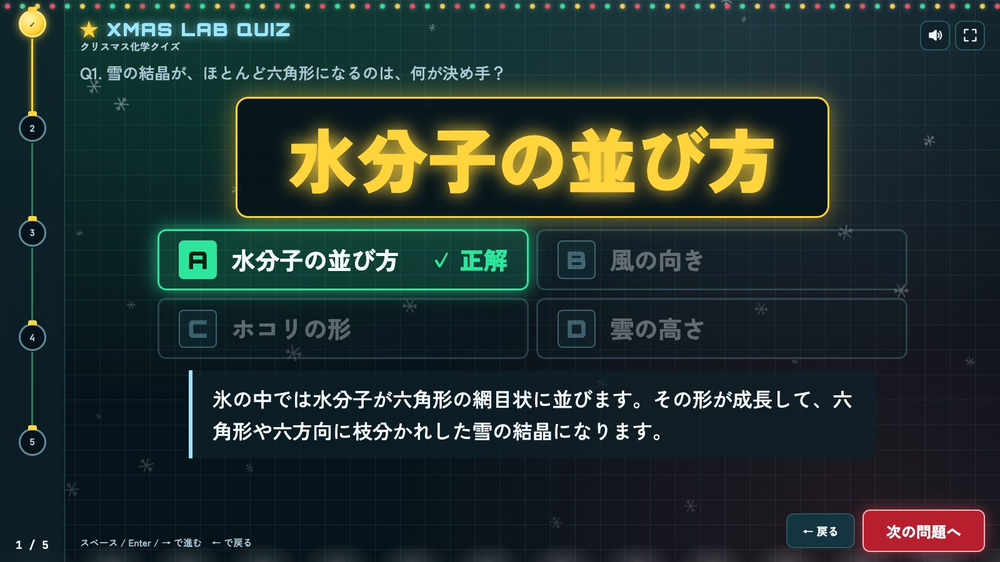

<p align="center"></p>

<p align="center"><b>原子番号がそのまま当選番号。クリスマスの「化学ラボ」で遊ぶ、ビンゴ・くじ引き・クイズの3点セット。</b></p>

<p align="center">
  
  
  
  
  
</p>

## English summary
Science Bingo is a set of three offline, single-page web apps for parties and classrooms, themed as a Christmas chemistry lab:
**Element Bingo** (drawn numbers are shown as periodic-table tiles), **Reaction Lottery** (1st/2nd/3rd prizes as Au/Ag/Cu test tubes) and **Lab Quiz** (TV-style three-screen quiz with a swappable question file).
Plain HTML/CSS/JavaScript: no build, no server, no npm, no network requests. Open `index.html` in Chrome or Edge and it works.
All fonts are bundled (SIL OFL 1.1). UI text is Japanese.

## 特長
- 🧪 **元素タイルで抽選**：番号を周期表のタイル（番号・元素記号・和名・分類）で表示
- ❄️ **クリスマス演出**：雪、電飾、ルーレット、紙吹雪、鈴とジングルベルの効果音（Web Audio で生成、音声ファイルなし）
- 📴 **完全オフライン**：フォントも同梱。外部通信は一切ありません
- 📦 **ビルド不要**：`index.html` をダブルクリックするだけ
- ♿ **アクセシビリティ配慮**：コントラスト 4.5:1 以上、フォーカス表示、視差効果の抑制
- 🖥️ **プロジェクター向け**：全画面ボタン、大きな文字、キーボードだけで進行可能

## アプリ

### 1. bingo-app：XMAS ELEMENT BINGO（クリスマス元素ビンゴ）


抽選した番号を**原子番号**として扱い、周期表タイルで表示します。

- **範囲指定**：最小値〜最大値の範囲で抽選します（初期値は 1〜75、整数で最大 999 個まで）。当選済みの番号は出ません。
- **ルーレット演出**：約2.6秒かけて減速し、0.4秒止めてから当選番号を表示します。表示時はフラッシュ、衝撃波、分子風のパーティクル、効果音が出ます。
- **任意番号の追加**：指定した番号を当選に加えます。範囲外・当選済みの番号は、入力欄の下にエラーを表示します。
- **過去の当選番号**：元素タイルで一覧表示し、「n / 全数 抽選済み」も表示します。
- 範囲が 1〜75 のときは、タイルに BINGO の列（B / I / N / G / O）のバッジも付きます。

操作：「抽選する」ボタン、または Space / Enter（入力欄やボタンにフォーカスがないとき）。

### 2. lottery-app：XMAS REACTION LOTTERY（クリスマス化学反応くじ）


1等は金（Au）、2等は銀（Ag）、3等は銅（Cu）の試験管で表します。

- **設定**：各等の当選人数を入力して「設定を反映」を押します。
- **抽選確率**：各等の**残数に比例**します（残り枠1つにつき候補1つ）。
- **残数表示**：試験管の液面と泡の数、「残り n」で残数を示します。
- **除外処理**：残数が 0 の等は当たりません。全枠が埋まると抽選ボタンは押せなくなります。
- **当選履歴**：抽選した順に一覧表示します。
- **演出**：等級に応じて派手さが変わります。1等は紙吹雪が約5秒、画面の揺れ、ジングルベル付きです。

操作：「抽選する」ボタン、または Space / Enter。

### 3. quiz-app：XMAS LAB QUIZ（クリスマス化学クイズ）
| 問題画面 | 正解画面 |
|---|---|
|  |  |

イベントの途中で行うクイズ用の画面です。次の3画面を繰り返します。

1. **待機画面**：TV番組のアイキャッチ風に「第N問」を表示します。
2. **問題画面**：上部の帯に問題文を1文字ずつ流します。中央に画像、その下に選択肢（あれば）を並べます。
3. **正解画面**：「正解は…」と溜めてから正解を大きく表示します。選択肢がある問題では正解に ✓ が付き、解説も出ます。

画面**左端の進行レール**で全体の何問目かがわかります（スマホ幅では画面上部）。

操作：Space / Enter / → で進む、← で戻る。画面のボタンでも操作できます。

### 共通の操作
| 操作 | 内容 |
|---|---|
| スピーカーボタン | 効果音のオン/オフ（設定はブラウザに保存） |
| 四隅の全画面ボタン | 全画面表示（プロジェクター向け） |

## クイズ問題の作り方
`quiz-app/questions.js` を書き換えます。画像は `quiz-app/images/` に置きます。

```js
window.QUIZ = { title: 'クイズ名', questions: [
  { question: '問題文', image: 'images/q1.svg', answer: '正解',
    choices: ['A', 'B', 'C', 'D'], explanation: '解説' },
] };
```

- 必須は `question` と `answer`。`image`、`choices`（2〜4個。あるとき `answer` はどれかと同じ文字に）、`explanation` は省略できます。
- **JSON で読み込む**：同じ形の JSON（`{ "title": "...", "questions": [...] }`）を、待機画面の「問題ファイルを読み込む」から読み込めます。
- **画像**：`images/` からの相対パス、または `data:image/...`（2MB 以下）。外部 URL は使えません。
- **上限**：ファイルは 2MB 以下、問題は 200 問以下、各項目は 2000 文字以下。

> [!WARNING]
> `questions.js` は **JavaScript としてそのまま実行**されます。自分で書いた（信頼できる）ものだけを置いてください。第三者から受け取った問題は、`questions.js` ではなく **JSON として読み込んで**ください（JSON はデータとして解析され、文字列として表示されるだけです）。

## 動作環境
- **Chrome / Edge** 向けです。macOS の Chrome で動作を確認しています。Edge（Windows）も同じ Chromium 系のため動作する想定ですが、本番前に一度開いて確認してください。
- `index.html` を**ダブルクリックして `file://` で開くだけ**で、オフラインで動きます。サーバー、ビルド、npm は不要です。
- 効果音は、ブラウザの自動再生ポリシーにより**最初のクリックやキー操作のあとから**鳴ります。
- Windows / macOS で同じ見た目になるよう、フォントの同梱とアイコンの SVG 化をしています（絵文字は使っていません）。

```
science_bingo/
├── bingo-app/      index.html, style.css, app.js, fonts/
├── lottery-app/    index.html, style.css, app.js, fonts/
├── quiz-app/       index.html, style.css, app.js, questions.js, images/, fonts/
├── fonts/          Zen Kaku Gothic New（日本語フォント）とそのライセンス
└── docs/           README 用のバナーとスクリーンショット
```

## セキュリティ / プライバシー
- **外部通信なし**：フォントを含め、すべて同梱です（CDN・Google Fonts は使いません）。
- **Content-Security-Policy**：各 `index.html` の meta で `default-src 'none'`、`connect-src 'none'` などを指定し、外部への接続と読み込みを禁止しています。
- **読み込んだ JSON は「データ」として扱います**：解析後は `textContent` 等の文字列として描画し、HTML としては解釈しません。
- **画像の許可リスト**：自分のフォルダ内の相対パスと `data:image` のみ。
- **入力の上限**：ビンゴの範囲（999 個まで）、クイズのファイルサイズ・問題数・文字数に上限を設けています。
- 個人情報は扱いません。ブラウザに保存するのはミュート設定のみです。

## アクセシビリティ
デジタル庁デザインシステムと WCAG 2.2 AA を参考にしています。

- 文字のコントラストは 4.5:1 以上、ボタンの高さは 48px 以上
- キーボード操作の位置がわかるフォーカス表示を常に出す
- 抽選結果などを `aria-live` で読み上げ、エラーは `alert()` ではなく入力欄の近くに文章で表示
- OS の「視差効果を減らす」（`prefers-reduced-motion`）に対応して演出を控えめに
- 点滅は 1 秒に 3 回以下
- 色だけで情報を伝えず、文字やアイコンも併記

## カスタマイズ
- **配色**：各 `style.css` 冒頭の CSS 変数（トークン）を変えるだけです。

  | 色 | 値 |
  |---|---|
  | 背景 | `#07131A` |
  | 赤 / 緑 / 金 | `#FF4D5E` / `#2EE59D` / `#FFD43D` |
  | 氷色 / 文字 | `#9BE7FF` / `#F4FBFF` |
- **効果音**：各 `app.js` 内の Web Audio による音の生成部分を編集します（音声ファイルは使っていません）。
- **クイズ**：上の「クイズ問題の作り方」を参照。

## 開発
ビルド工程はありません。ファイルを編集してブラウザを再読み込みするだけです。HTML / CSS / JavaScript のみで、外部ライブラリには依存していません。

## ライセンス
ソースコードは [MIT License](LICENSE) です。

同梱フォントは **SIL Open Font License 1.1** です。ライセンス本文は各フォントの隣に置いてあります。

- `bingo-app/fonts/`、`lottery-app/fonts/`、`quiz-app/fonts/`：`OFL-Orbitron.txt`、`OFL-JetBrainsMono.txt`
- `fonts/zen-kaku-gothic-new/OFL.txt`

## クレジット
- [Orbitron](https://github.com/theleagueof/orbitron)：The Orbitron Project Authors（The League of Moveable Type）
- [JetBrains Mono](https://github.com/JetBrains/JetBrainsMono)：The JetBrains Mono Project Authors
- [Zen Kaku Gothic New](https://github.com/googlefonts/zen-kakugothic)：The Zen Project Authors
